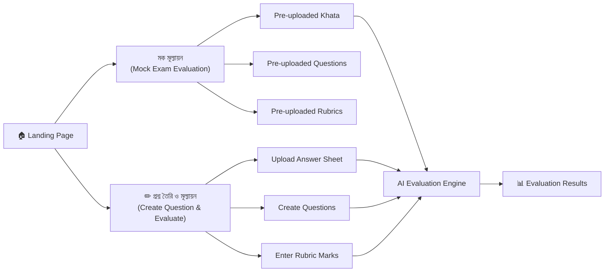
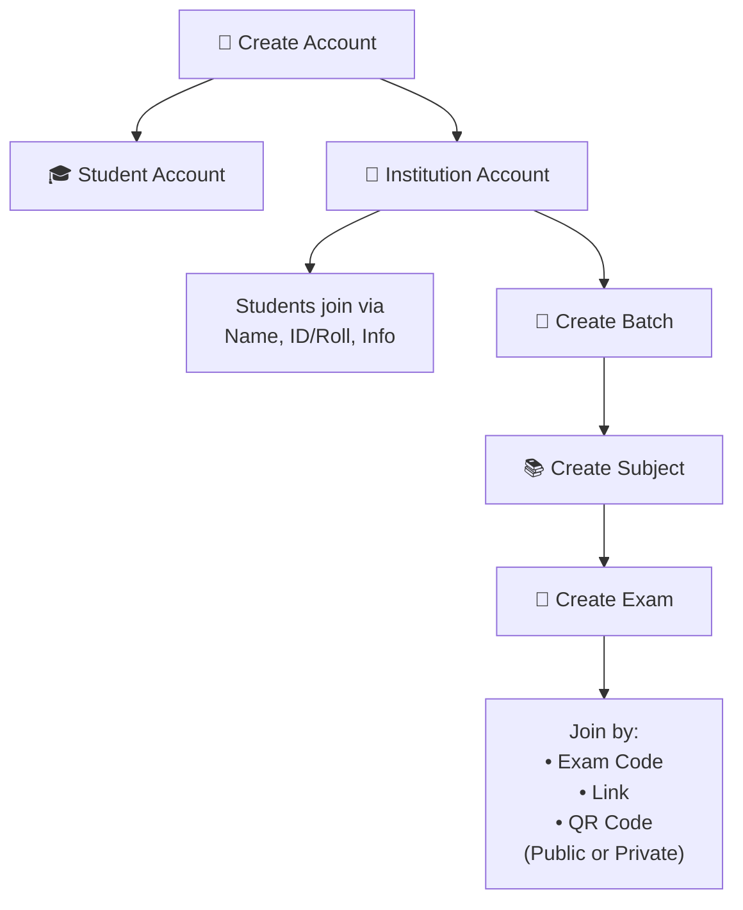
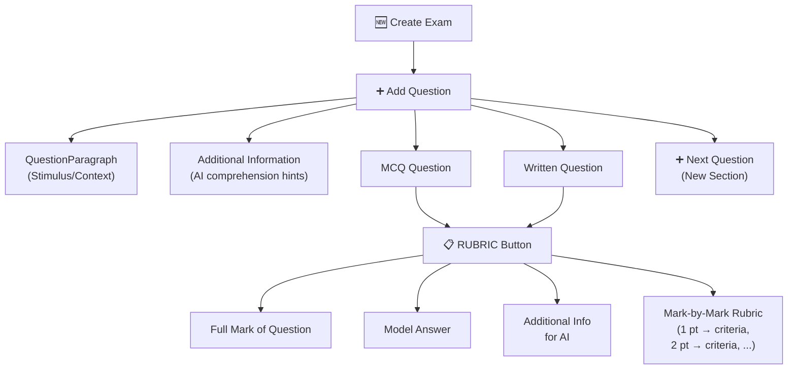
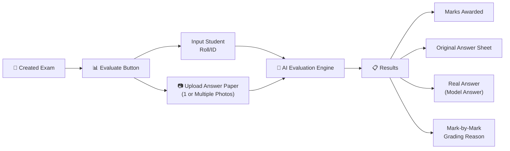
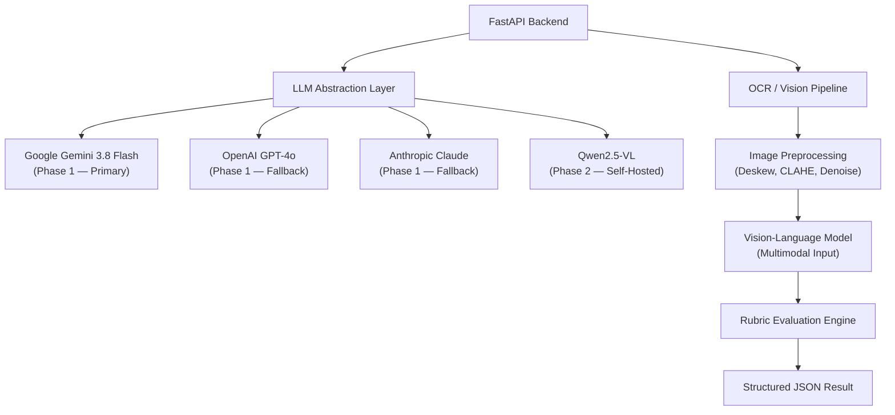
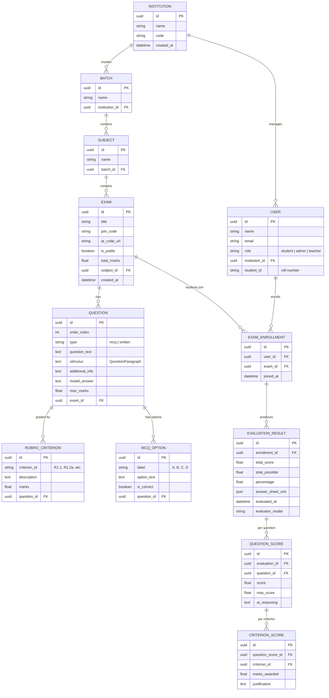
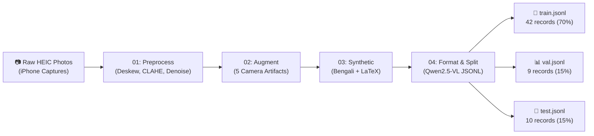
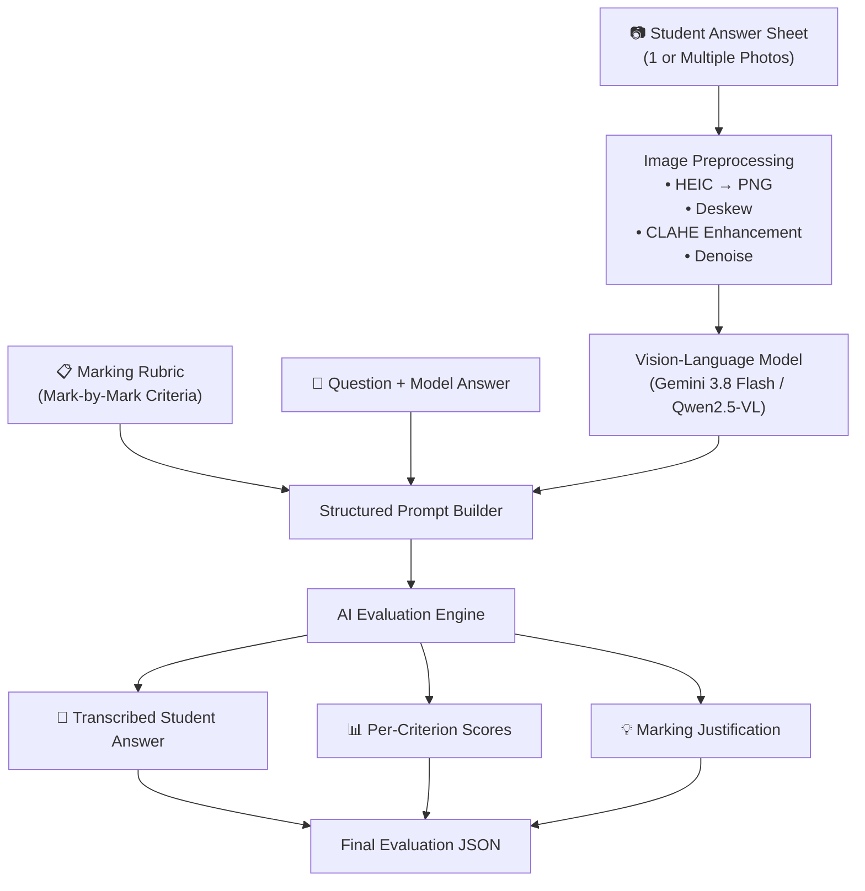
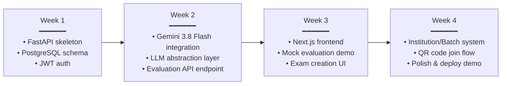

# Khata AI — System Architecture & Engineering Roadmap

> **Project:** Khata AI — Automated Handwritten Exam Evaluation  
> **Version:** 2.0.0  
> **Date:** November 2026  
> **Team Role — Member 2:** Data Engineering & Preprocessing Lead

---

This document outlines the core architecture, unified LLM abstraction interface, database models, and execution roadmap for the **Khata AI Exam Evaluation Platform**. It specifies the architectural bridge between an immediate commercial foundation (Phase 1 — VC demonstration) and proprietary core IP defensibility (Phase 2 — self-hosted fine-tuned models).

---

## 1. Executive Summary & Core Philosophy

The primary objective is to deliver a functional, reliable **handwritten exam evaluation engine** for upcoming investor demonstrations while laying an extensible architectural foundation for proprietary, on-premise model deployment.

- **Immediate Demo Delivery (Phase 1):** Fast integration with commercial high-capability APIs (Google Gemini 3.8 Flash, OpenAI GPT, Anthropic Claude). This validates customer workflow, rubric-based marking, topic coverage, and curriculum mapping inside subject modules.
- **Proprietary Fine-Tuning (Phase 2):** Self-hosted fine-tuned models (Qwen2.5-VL) trained on the curated multimodal dataset for Bengali handwritten exam evaluation, providing cost reduction and IP defensibility.

---

## 2. Web Platform Architecture

### Frontend Client Layer (Next.js & React)

#### 2.1 Live Demo Section



| Feature | Description |
|:---|:---|
| **মক মূল্যায়ন (Mock Evaluation)** | Pre-uploaded khata (answer sheets), questions, answers, and mark-by-mark rubrics are already in the system. Users click "Evaluate" to see the AI grade instantly. |
| **✏ প্রশ্ন তৈরি ও মূল্যায়ন (Create & Evaluate)** | Teachers upload their own answer sheets, create custom questions, enter rubric marks, and the backend API evaluates through the AI pipeline. |

#### 2.2 Account & Institution System



| Entity | Description |
|:---|:---|
| **Institution** | Admin creates the institution; manages batches, subjects, and exams. |
| **Student** | Joins an institution by providing name, ID/roll, and info. Can join exams via code, link, or QR. |
| **Batch** | Organizational unit within an institution (e.g., "HSC 2026 Batch A"). |
| **Subject** | Created inside a batch (e.g., "Physics 2nd Paper"). |
| **Exam** | Created inside a subject with questions, rubrics, and evaluation settings. |

#### 2.3 Exam Creation Flow (Critical Module)

> [!IMPORTANT]
> This is the most complex UI component and requires focused design attention.



**Exam Creation Elements:**

| Element | Description |
|:---|:---|
| **QuestionParagraph** | The stimulus or context paragraph shared across sub-questions (e.g., "P-V diagram with T₁ = 827 K, Q₁ = 500 J, T₂ = 387 K") |
| **Additional Information** | Extra context to help the AI understand question intent |
| **MCQ** | Multiple-choice question with options |
| **Written Question** | Free-response question requiring handwritten answers |
| **RUBRIC Button** | Opens rubric editor for each question — input full marks, model answer, and mark-by-mark criteria |
| **Mark-by-Mark Rubric** | For each mark allocation (1 pt, 1.5 pt, etc.), specify the exact criteria required in the answer |

#### 2.4 Evaluation Flow



**Students can view:**
- Their uploaded answer sheet photos
- The AI-assigned marks per question
- The model (correct) answer for each question
- Detailed reasoning for each mark allocation

---

## 3. Backend API Architecture

### 3.1 Unified LLM Abstraction Interface

> [!NOTE]
> The LLM abstraction layer allows seamless switching between commercial APIs (Phase 1) and self-hosted fine-tuned models (Phase 2) without changing any business logic.



### 3.2 Core API Endpoints

| Endpoint | Method | Description |
|:---|:---|:---|
| `/api/v1/auth/register` | POST | Register student or institution account |
| `/api/v1/auth/login` | POST | JWT-based authentication |
| `/api/v1/institutions/{id}/batches` | POST | Create batch within institution |
| `/api/v1/batches/{id}/subjects` | POST | Create subject within batch |
| `/api/v1/subjects/{id}/exams` | POST | Create exam with questions & rubrics |
| `/api/v1/exams/{id}/questions` | POST | Add questions (MCQ/Written) with rubrics |
| `/api/v1/exams/{id}/evaluate` | POST | Upload answer sheet photos & trigger AI evaluation |
| `/api/v1/exams/{id}/results/{student_id}` | GET | Retrieve evaluation results with reasoning |
| `/api/v1/exams/{id}/join` | POST | Student joins exam by code/link/QR |
| `/api/v1/demo/mock-evaluate` | POST | Demo endpoint with pre-loaded data |

### 3.3 Technology Stack

| Layer | Technology | Purpose |
|:---|:---|:---|
| **Frontend** | Next.js 14, React, Tailwind CSS | SSR/CSR hybrid, responsive UI |
| **Backend API** | FastAPI (Python 3.10+) | High-performance async API server |
| **Database** | PostgreSQL + Prisma ORM | Relational data, exam structures, rubrics |
| **File Storage** | AWS S3 / Cloudflare R2 | Answer sheet images, question papers |
| **Auth** | JWT + OAuth2 (Google) | Secure authentication |
| **AI/ML** | Gemini 3.8 Flash, Qwen2.5-VL | Multimodal vision-language evaluation |
| **Queue** | Celery + Redis | Async evaluation job processing |
| **Deployment** | Docker, Railway / GCP | Containerized microservices |

---

## 4. Database Models

### 4.1 Entity-Relationship Diagram



---

## 5. Current Data Engineering Pipeline (Completed)

> [!TIP]
> This pipeline is fully operational and has already produced the training dataset used for benchmarking with Gemini 3.8 Flash.



### Pipeline Components

| Step | Script | Description |
|:---|:---|:---|
| **01 — Preprocess** | `scripts/01_preprocessing/preprocess.py` | HEIC→PNG conversion, deskewing, CLAHE contrast enhancement, background noise removal |
| **02 — Augment** | `scripts/02_augmentation/camera_augmentor.py` | 5 realistic camera artifacts: perspective tilt, dynamic shadows, low lighting, paper folds, spatial blur |
| **03 — Synthetic** | `scripts/03_synthetic/synthetic_generator.py` | Bengali handwriting on ruled paper + complex LaTeX STEM equation rendering |
| **04 — Format** | `scripts/04_formatting/format_and_split.py` | Qwen2.5-VL chat JSONL formatting with deterministic 70/15/15 split |
| **Master Runner** | `scripts/run_pipeline.py` | One-command full pipeline execution |
| **Visual Dashboard** | `scripts/generate_visual_report.py` | Interactive HTML report for visual inspection |

### Current Benchmark Results

| Metric | Value |
|:---|:---|
| **Evaluator Model** | Gemini 3.8 Flash |
| **Ground Truth Source** | Human Evaluator Red-Ink Markings |
| **Total Exams** | 3 (Physics 2nd Paper, Fluids & Pressure, Electrostatics) |
| **Total Students Evaluated** | 65 |
| **Dataset Records** | 61 multimodal samples |
| **Subjects Covered** | Thermodynamics, Relativity, Wheatstone Bridge, Electrostatics, Semiconductors, Fluids, Buoyancy, Capacitance, Coulomb Force |

---

## 6. AI Evaluation Pipeline Architecture



### Evaluation Prompt Structure

```
System: You are an expert exam evaluator. Given the student's handwritten 
answer sheet image, the original question, model answer, and mark-by-mark 
rubric criteria, evaluate the student's response.

For each rubric criterion:
1. Check if the student's answer satisfies the criterion
2. Award marks (full, partial, or zero)
3. Provide specific justification referencing the student's actual writing

Input:
- Question Text: {question_text}
- Stimulus: {stimulus}
- Model Answer: {model_answer}
- Rubric: {rubric_criteria}
- Student Answer Image: {image}

Output: Structured JSON with per-criterion scores and reasoning
```

---

## 7. Execution Roadmap

### Phase 1 — VC Demo & Commercial API Integration (Current → Week 4)



| Week | Deliverable | Owner |
|:---|:---|:---|
| **Week 1** | FastAPI project structure, PostgreSQL + Prisma schema, JWT auth, user registration | Backend |
| **Week 2** | Gemini 3.8 Flash API integration, LLM abstraction interface, `/evaluate` endpoint with rubric-based grading | AI/Backend |
| **Week 3** | Next.js frontend with Mock Evaluation demo, Exam Creation UI with rubric editor | Frontend |
| **Week 4** | Institution → Batch → Subject → Exam hierarchy, QR code/link join, deployment on Railway/GCP | Full Stack |

### Phase 2 — Proprietary Model & Scale (Week 5 → Week 12)

| Week | Deliverable |
|:---|:---|
| **Week 5–6** | Fine-tune Qwen2.5-VL on curated 61-record multimodal dataset + expanded synthetic data |
| **Week 7–8** | Self-hosted model deployment (GPU server), A/B test against Gemini 3.8 Flash |
| **Week 9–10** | Batch evaluation (bulk khata upload), async Celery job queue, progress tracking |
| **Week 11–12** | Analytics dashboard (class performance, question difficulty), export to CSV/PDF reports |

### Phase 3 — Product Market Fit (Week 13+)

| Milestone | Description |
|:---|:---|
| **Multi-Subject Expansion** | Extend beyond Physics to Chemistry, Math, Biology, Bengali, English |
| **MCQ Auto-Grading** | OMR-style bubble sheet detection with computer vision |
| **Mobile App** | React Native companion app for answer sheet photo capture |
| **Offline Mode** | Edge-deployed lightweight model for areas with poor connectivity |
| **API Marketplace** | Third-party institution integration via public REST API |

---

## 8. Rubric Data Model (Example)

> [!NOTE]
> This is the actual rubric structure from EXAM_001 — Physics 2nd Paper, demonstrating the mark-by-mark granularity that powers the AI evaluation.

```json
{
  "question_number": 1,
  "topic": "Thermodynamics & Carnot Cycle",
  "stimulus": "P-V diagram: T₁ = 827 K, Q₁ = 500 J, T₂ = 387 K",
  "subquestions": [
    {
      "id": "1(ক)",
      "type": "Knowledge (জ্ঞানমূলক)",
      "max_marks": 1.0,
      "question": "তাপ ইঞ্জিন কাকে বলে?",
      "model_answer": "যে যন্ত্র তাপশক্তিকে অবিরামভাবে যান্ত্রিক শক্তিতে রূপান্তরিত করে...",
      "rubric": [
        { "criterion": "R1.1", "marks": 1.0, "desc": "তাপশক্তিকে যান্ত্রিক শক্তিতে রূপান্তরকারী যন্ত্র হিসেবে উল্লেখ" }
      ]
    },
    {
      "id": "1(ঘ)",
      "type": "Higher Ability (উচ্চতর দক্ষতা)",
      "max_marks": 4.0,
      "question": "তাপগ্রাহকের তাপমাত্রা দ্বিগুণ করলে দক্ষতা অর্ধেক হবে কিনা—বিশ্লেষণ কর।",
      "rubric": [
        { "criterion": "R1.4a", "marks": 1.0, "desc": "প্রারম্ভিক η₁ = 53.20% নির্ভুল গণনা" },
        { "criterion": "R1.4b", "marks": 1.5, "desc": "দ্বিগুণ তাপমাত্রায় η₂ = 6.41% গণনা" },
        { "criterion": "R1.4c", "marks": 1.5, "desc": "η₂/η₁ = 0.12 তুলনা ও সিদ্ধান্ত" }
      ]
    }
  ]
}
```

---

## 9. Security & Data Safety

| Concern | Mitigation |
|:---|:---|
| **Raw Data Integrity** | Original `.heic` files are 100% read-only — never moved, modified, or deleted by any script |
| **Student PII** | Roll numbers and names encrypted at rest; access scoped to institution admin |
| **API Keys** | Gemini/OpenAI keys stored in environment variables, never committed to git |
| **Image Upload** | File type validation, size limits (20MB max), virus scanning |
| **Authentication** | JWT tokens with 24h expiry, refresh token rotation |
| **RBAC** | Role-based access: Student (view own results), Teacher (evaluate), Admin (manage institution) |

---

## 10. Project Directory Structure

```text
khata-ai/
├── frontend/                      # Next.js 14 Frontend
│   ├── app/                       # App Router pages
│   │   ├── (auth)/               # Login, Register
│   │   ├── dashboard/            # Institution dashboard
│   │   ├── exam/                 # Exam creation & evaluation
│   │   └── demo/                 # Mock evaluation demo
│   ├── components/               # React components
│   └── lib/                      # API client, utils
│
├── backend/                       # FastAPI Backend
│   ├── api/                      # Route handlers
│   │   ├── auth.py              # Authentication endpoints
│   │   ├── institutions.py      # Institution CRUD
│   │   ├── exams.py             # Exam & question management
│   │   └── evaluate.py          # AI evaluation endpoint
│   ├── core/                    # Core business logic
│   │   ├── llm_abstraction.py   # Unified LLM interface
│   │   ├── evaluation_engine.py # Rubric-based grading
│   │   └── image_processor.py   # Preprocessing pipeline
│   ├── models/                  # SQLAlchemy / Prisma models
│   ├── schemas/                 # Pydantic request/response schemas
│   └── workers/                 # Celery async tasks
│
├── data-pipeline/                 # [EXISTING] Data Engineering Pipeline
│   ├── scripts/                  # Preprocessing, augmentation, formatting
│   ├── configs/                  # Pipeline YAML configuration
│   ├── evaluations/             # Benchmark results & rubrics
│   └── aiTrainingData/          # Curated multimodal dataset
│
├── docker-compose.yml            # Multi-service orchestration
├── .env.example                  # Environment variable template
└── README.md                    # Documentation
```

---

> [!CAUTION]
> **Phase 1 Priority:** The VC demo must work end-to-end with **Gemini 3.8 Flash** before any self-hosted model work begins. The mock evaluation demo with pre-loaded Physics exam data is the critical path deliverable.
